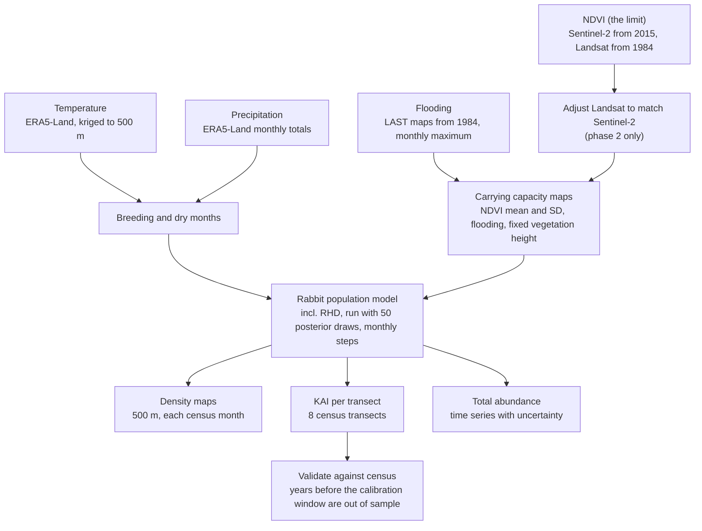

# Doñana rabbit backcast: plan and status

*Updated 2 November 2026*

We will reconstruct monthly rabbit densities across Doñana back to 2015 using the calibrated rabbit
model, and in a second phase back to 1985. Sentinel‑2 NDVI, the vegetation input the model was
calibrated on, only starts in July 2015. To go further back we will use Landsat NDVI that has been
adjusted to match Sentinel‑2. Before the model is recalibrated, the RHD disease process in the
model will be rebuilt so outbreaks follow immunity in the population (see
[RHD disease model](#rhd-disease-model-planned-update)).

**Contents**

- [How far back the data go](#how-far-back-the-data-go)
- [Approach: two phases](#approach-two-phases)
- [Workflow](#workflow)
- [Outputs](#outputs)
- [Validation](#validation)
- [Issues found in the calibration inputs](#issues-found-in-the-calibration-inputs)
- [RHD disease model: planned update](#rhd-disease-model-planned-update)
- [Caveats and assumptions](#caveats-and-assumptions)
- [Open questions](#open-questions)
- [Sources](#sources)
- [Appendix: code](#appendix-code)

## How far back the data go

NDVI limits how far back we can go. Every other input reaches back to at least 1984. We checked the
dates below directly in each data catalogue on 2 November 2026.

| Input | Source | Earliest data over Doñana | Resolution |
| --- | --- | --- | --- |
| NDVI (Sentinel‑2), used from now on | Sentinel‑2 L2A via Microsoft Planetary Computer | **12 Jul 2015** | 10 m |
| NDVI (Sentinel‑2), used until now | Sentinel‑2 L2A via AWS Earth Search | 3 Nov 2016 | 10 m |
| NDVI (Landsat 5/7/8/9) | Landsat Collection 2 L2 via Planetary Computer | **22 Mar 1984** | 30 m |
| Flooding | LAST Doñana flood maps (ICTS geoserver, 451 maps) | **10 Sep 1984** | 30 m |
| Temperature | ERA5‑Land monthly means, kriged on a DEM | 1950 | ~9 km → 500 m |
| Precipitation | ERA5‑Land monthly means | 1950 | ~9 km → 500 m |

## Approach: two phases

We run the backcast in two phases because only Sentinel‑2 matches the data the model was calibrated
on. The model's habitat suitability uses the mean and the within‑cell variability (SD) of 10 m
Sentinel‑2 NDVI inside each 500 m cell. A different sensor changes both values.

| | Phase 1 | Phase 2 |
| --- | --- | --- |
| Period simulated | 2015 → present | 1985 → present |
| Spin‑up year (results not reported) | 2015 | 1985 |
| NDVI source | Sentinel‑2 only | Landsat adjusted to Sentinel‑2 before July 2015, Sentinel‑2 afterwards |
| Matches the calibration data | Yes | No, an extrapolation |
| Main extra work | Climate and flood data for the backcast years | Landsat download, Landsat‑to‑Sentinel‑2 adjustment, 20 years of climate data |
| RHD | Present from the start (endemic) | Absent until the official first arrival, then simulated |

Each run draws 50 parameter sets from the calibration posterior so the maps carry parameter
uncertainty. The model will be recalibrated first, on the corrected inputs and with the new RHD
process.

## Workflow

All inputs are put on the same 500 m monthly grid before the model runs. Only the NDVI branch needs
new processing in phase 2.

Climate sets the breeding season and drought stress. NDVI, flooding and vegetation height set
carrying capacity. The model combines both for each posterior draw.

## Outputs

Each phase produces the following:

- **Density maps** at 500 m for every census month, giving the mean, SD and 95% interval across the
  50 posterior draws.
- **Simulated KAI per census transect** (8 transects), in the same form as the census index.
- **A total abundance time series** for the whole study area, with uncertainty bands, as a CSV file
  and a figure.
- **A simulated vs observed KAI figure** per transect, with the calibration window marked.
- **Monthly 500 m environmental data** (NDVI mean and SD, flooding, temperature, precipitation) for
  the full period. These can be reused in other analyses.
- **RHD outbreak log** (planned): date, cell and deaths of every simulated outbreak.

## Validation

The census starts in April 2005. Census data from before the calibration window are not used in
calibration, so they give an independent test of the backcast.

1. **Data coverage check.** Each environmental series must cover every month of the period with no
   duplicate months. We list any gaps and how they were filled.
2. **Landsat adjustment check (phase 2).** Keep 2023–2025 out of the fit. Report the error and bias
   of the adjusted Landsat values against real Sentinel‑2, overall and at the 8 transects.
3. **Consistency with calibration.** The calibration years of the backcast should match the
   in‑sample calibration fit.
4. **Out‑of‑sample test.** Compare simulated and observed KAI per transect for census years before
   the calibration window.
5. **RHD.** Simulated park‑wide outbreaks should recur every 2–3 years, with none before the
   official first arrival.

## Issues found in the calibration inputs

Three problems surfaced while building the backcast. All affected the 2017–2024 calibration, which
is why the model will be recalibrated.

| Issue | Evidence | Status |
| --- | --- | --- |
| **Temperature was labelled one month early.** The kriged file for "January 2025" held February 2025. | Kriged means matched the raw ERA5‑Land value of the following month (e.g. 12.66 °C vs February 12.49 °C, January 11.86 °C). | **Fixed.** Files now carry the month their data are for and are stamped on the 15th. All 263 months (Nov 2004 – Sep 2026) match raw ERA5‑Land for the same month within 0.13 °C on average (old labels: 2.8 °C). |
| **The calibrated dispersal settings had no effect.** The program read them from the command line but then overwrote them with the values in the demographic rates file. | Runs with very different dispersal settings (e.g. preferred density 10 vs 2) gave identical output; the model always used the file values. | **Fixed** in the model code (branch `rhd-immunity`). The current posterior for these three settings is meaningless. |
| **Cloudy months left cells with no NDVI, and those cells got zero carrying capacity.** | The old inputs lacked NDVI for 1,993 of 2,627 study‑area cells in Feb–Mar 2017 and 1,821 in Jan–Feb 2018. With these gaps the simulated population died out in February 2018. | **Fixed in the input data (rebuild running).** See below. |

The NDVI series is rebuilt with these changes:

- **Source:** Planetary Computer instead of AWS. AWS had no scenes for January 2018 and one for
  February 2018; Planetary Computer has 20 and 22, and data from July 2015.
- **Cloud filter:** scenes are kept up to 60% cloud cover (was 20%). Clouds are still removed per
  pixel.
- **Clear pixels:** a cell needs at least 25% clear 10 m pixels to count as observed.
- **Gap filling:** remaining gaps are filled per cell by interpolating between the nearest observed
  months, with a layer recording which values were filled.
- **Coverage:** downloads now cover the whole model grid (13 edge cells were never covered before).
- **Safeguard:** the model now stops with an error if any cell inside the study area lacks NDVI,
  instead of silently setting its carrying capacity to 0.

## RHD disease model: planned update

**Status (2 Nov 2026):** implemented in the model code (branch `rhd-immunity`, not yet committed)
and in the R functions; the calibration scripts are ready but not run. All settings are described in
[docs/model_settings.md](../docs/model_settings.md). First test runs show that the outbreak interval
per area follows the threshold `RHD_f_crit` as intended (median 11 to 84 months for thresholds 0.3
to 0.9), but park‑wide waves need strong enough spread between areas: with weak spread the
park‑wide signal is a yearly pulse from the breeding season, and spread by dispersal alone dies out
after one or two steps.

### Why

The current model has a fixed outbreak schedule: each cell gets a random interval of 24–36 months
and a mortality of 15–25% of adults. There is no immunity, no link to the population, and no spread
between cells, so the 2–3 year rhythm is imposed rather than produced. A bug also means that cells
that only become habitat after the first month never have outbreaks.

What we know: outbreaks occur when there are enough non‑immune adults, they recur roughly every
2–3 years across the park, and they spread between areas. Two strains have reached Doñana: the
classical virus (RHDV1, GI.1) around 1989 and the variant (RHDV2, GI.2) in 2011–2012.

### What the literature gives

Only the arrival dates and the population declines after each arrival are well documented.
Per‑strain mortality, cross‑immunity and outbreak frequency are too variable or unmeasured to give
the two strains separate settings, so the model uses **one disease process with two arrival events**.

| | RHDV1 (classical, GI.1) | RHDV2 (variant, GI.2) |
| --- | --- | --- |
| **Arrival** | First Spanish cases June 1988 [3]. First wave in Doñana around 1990 [2]. | First found in Spain in 2011, on farms and in a wild population; in most of Spain from 2012 [1]. |
| **Population effect** | First wave: 55–75% mortality in Iberia [1], about 60% decline in Doñana [2]. Doñana's rabbits are now under 10% of pre‑RHD numbers [2]. Mortality has fallen since, partly through host resistance [1]. | Coto del Rey fell by more than 80% in 2012–2013, with similar declines in other Doñana populations [1]. |
| **Adult mortality** | No individual case fatality figure found; only the population decline above. | Very variable: 0–100% case fatality within single studies; under 5% in adult females in one farm outbreak [5, 6]. |
| **Young rabbits** | Little disease below about 5–8 weeks [4], although one trial found 84% mortality below 4 weeks [6]. | Kills kits from 11 days old [1]; 70–100% mortality in young rabbits [5]. |
| **Cross‑immunity** | – | Partial and not quantified. RHDV2 kills rabbits vaccinated against RHDV1 [1] and replaced RHDV1 in Iberia [7, 8]. |
| **Maternal antibodies** | Found in juveniles up to 2 months; seropositive from 5 months (Portugal) [9]. | Same. |
| **Outbreak frequency** | No Doñana‑ or strain‑specific measurements found. | Same. |

Two numbers are robust and specific to Doñana: the decline of the first wave (about 60%) and the
decline of 2012–2013 (more than 80%). These, with the 2–3 year rhythm, are what the model is
calibrated against.

### Mechanism

**Rabbits** are immune or susceptible. Kits of immune mothers are protected by maternal antibodies
until they are 4 months old.

**Susceptible rabbits** are those aged 4 months or older (the age at which they disperse) that are
neither immune nor protected. Each month, for each cell after the first arrival:

1. **Susceptible share.** Count susceptible rabbits; their share of all rabbits aged 4 months or
   older is `f`.
2. **Exposure.** A cell is exposed when the virus reaches it:
   - **by dispersal:** a rabbit infected in an outbreak disperses into the cell. This is the main
     route between cells, as 4‑month‑olds may carry the disease to their new warren;
   - **from neighbours (optional):** a neighbouring cell had an outbreak last month, with probability
     `RHD_spread`, standing in for vectors such as flies and for carcasses;
   - **by background introduction:** a small probability per cell per month (`RHD_spark`).
3. **Outbreak.** An exposed cell has an outbreak with a probability that rises steeply once `f`
   passes `RHD_f_crit`. This is the "enough non‑immune adults" rule; the smooth curve makes the
   calibration better behaved than a hard threshold.
4. **During an outbreak.** Susceptible rabbits are infected and a share `RHD_mortality` of them dies.
   Survivors become immune for life. Infected 4‑month‑olds that disperse that month carry the virus
   to their new cell.
5. **The cycle.** After an outbreak most survivors are immune. `f` rises again as they die and new
   rabbits reach 4 months without immunity. The time this takes sets the outbreak interval, and
   that is what the calibration tunes.

The minimum age of 4 months simplifies RHDV2, which also kills much younger kits. Kits are protected
by maternal antibodies for up to about 2 months [9], and they are only counted as part of the
population after weaning.

### Arrival events

| Setting | RHDV1 arrival | RHDV2 arrival |
| --- | --- | --- |
| Date | around 1989 (to confirm with the park) | 2011–2012 (to confirm with the park) |
| What happens | the disease starts in the seed cells; before this date there is no disease | a new strain arrives that existing immunity barely protects against |
| Immunity | – | by default everyone becomes susceptible again (`RHD2_cross_immunity` = 0); partial protection can be set, but there is no figure to calibrate it |
| Mortality | `RHD_mortality` (calibrated) | the same value, or a separate `RHD2_mortality` only if one value cannot reproduce both declines |
| Seed cells | share of occupied cells at random, or a list of cells | same |

- **Runs that start after arrival** (phase 1, the calibration, forecasts) start with an immune share
  that varies randomly between cells, so they don't begin with one artificial park‑wide outbreak.
- **Old behaviour stays available:** the disease settings sit in their own file, and the mode
  `none`, `schedule` (current) or `immunity` (new) is chosen there, so existing runs can be
  reproduced.

### Calibration

**Calibrated settings** (three to four): the outbreak threshold `RHD_f_crit`, the spread settings
(`RHD_spark` and, if used, `RHD_spread`), and `RHD_mortality`.

**Targets:**

- **Outbreak rhythm:** the median interval between park‑wide outbreak waves is 30 months, with most
  between 24 and 36. A wave is a peak in the monthly share of occupied cells with an outbreak, with
  peaks at least 6 months apart. The target range, the wave definition and the scale (`park` or
  `cell`) are settings.
- **First wave:** the population falls by about 55–75% (around 60% in Doñana) after the RHDV1
  arrival.
- **RHDV2 wave:** the population falls by more than 80% after the RHDV2 arrival, as in Coto del Rey
  in 2012–2013. This wave is within the census period, so it also shows in the KAI fit.
- **Also required:** outbreaks reach most occupied cells within 3 years, and the population does not
  go extinct.

Steps:

0. **Sensitivity scan.** A grid over the threshold, the spread settings and the mortality shows
   which settings control the interval and the size of the declines. Settings with little effect
   are fixed.
1. **Disease‑only calibration.** Approximate Bayesian computation (as in the current calibration),
   with the habitat and demography settings held fixed, over the period from the RHDV1 arrival with
   real covariates.
2. **Joint recalibration.** The disease settings from step 1 become the starting point for the full
   recalibration, which adds the outbreak interval to the two KAI fit statistics. This has to be
   joint: disease deaths lower the population, so the habitat settings will shift.

### Checks

1. With disease mode `none` and a fixed random seed, output matches a run without any disease code.
2. With mode `schedule`, output matches the current program.
3. No RHD deaths or immune rabbits before the RHDV1 arrival; afterwards an outbreak front spreads
   from the seed cells.
4. A single cell with constant carrying capacity shows regular outbreaks, and a higher threshold
   gives longer intervals.
5. With the calibrated settings, park‑wide waves recur every 24–36 months, the two declines fall in
   the target ranges, and the KAI fit doesn't get worse.

## Caveats and assumptions

| Issue | Effect on the backcast | How we handle it |
| --- | --- | --- |
| **Vegetation height is a single recent map**, held constant over time. | Shrub growth, fires and clearing since 1985 are not captured. | Assumption stated. Historical height data would remove it. |
| **Pre‑2015 NDVI comes from adjusted Landsat (phase 2).** | Adds error that the posterior spread does not include, so phase 2 uncertainty bands are too narrow. | Report the hold‑out error. Mark phase 2 results as an extrapolation. |
| **Landsat 5 has no overlap with Sentinel‑2.** It stopped in 2011. | The Landsat 5 adjustment goes via Landsat 7 (overlap 1999–2011), which adds a second step of error. | Validate each step separately. |
| **Filled NDVI values.** | Some months and cells are interpolated, not observed. | A layer records which values were filled; January–June 2015 (phase 1 spin‑up) uses the 2016–2018 average for each month. |
| **Model start‑up.** The model starts at carrying capacity. | The first year is not realistic. | Treat the first year as spin‑up and leave it out of results. |
| **RHD is simplified.** One disease process for both strains, lifelong immunity, no disease below 4 months, no myxomatosis. | Outbreak timing and severity are approximate, especially before the census starts. | Calibrated to the park‑wide 2–3 year rhythm and the two documented declines; results before 2005 cannot be checked against the census. |
| **Sentinel‑2 processing change in January 2022.** From that date ESA adds a fixed offset to Sentinel‑2 reflectances, and our pipeline does not remove it. | A possible step in NDVI from 2022 onwards. | To check in the rebuilt series before recalibrating. |

## Open questions

- [ ] Official first arrival dates (and first locations) of RHDV1 and RHDV2 in Doñana; the park's
      monitoring team may have them.
- [ ] Should the primary papers behind the decline figures [1, 2] be checked before the report is
      shared more widely?
- [ ] Which census years before 2017 can we use for the out‑of‑sample test, and were the methods
      comparable?
- [ ] Are there historical vegetation height or shrub cover maps to replace the single recent map?
- [ ] Are there records of rabbit releases in Doñana that would help interpret differences from the
      census?
- [ ] How large can the Landsat adjustment error be before phase 2 is not worth reporting?

## Sources

Found with a web search on 2 November 2026. Figures were read from the abstracts or summaries of
these pages; the primary papers behind them have not all been checked.

1. Delibes‑Mateos M. et al. (2014). Ecosystem effects of variant rabbit hemorrhagic disease virus,
   Iberian Peninsula. *Emerging Infectious Diseases* 20(12).
   [PMC4257825](https://pmc.ncbi.nlm.nih.gov/articles/PMC4257825/) ·
   [CDC](https://wwwnc.cdc.gov/eid/article/20/12/14-0517_article)
2. Long‑term decline of the European wild rabbit (*Oryctolagus cuniculus*) in south‑western Spain.
   *Wildlife Research* WR06142. [CSIRO Publishing](https://publish.csiro.au/wr/WR06142)
3. Myxomatosis and rabbit haemorrhagic disease: a 30‑year study of the occurrence on commercial farms
   in Spain. [PMC6827050](https://www.ncbi.nlm.nih.gov/pmc/articles/PMC6827050/)
4. Emerging rabbit hemorrhagic disease virus 2 (RHDVb), Australia. *Emerging Infectious Diseases*
   21(12). [PMC4672455](https://www.ncbi.nlm.nih.gov/pmc/articles/PMC4672455/) ·
   [CDC](https://wwwnc.cdc.gov/eid/article/21/12/15-1210_article)
5. Review of GI.2, *Viruses* (June 2021).
   [DOAJ](https://doaj.org/article/b43a221342eb44fa9fd90a1dc8d20493) ·
   [Virologica Sinica 2022](https://www.virosin.org/fileZGBDX/journal/article/vs/2022/4/PDF/17%205742.pdf)
6. Challenge trial comparing GI.1b and GI.2 mortality, Universidad de Zaragoza.
   [Zaguan](https://zaguan.unizar.es/record/78920/files/texto_completo.pdf)
7. Replacement of classical RHDV by RHDV2 in Portugal.
   [Universidade de Lisboa](https://repositorio.ulisboa.pt/entities/publication/ed81f9ee-dc6c-4174-a2e6-b2a646aedf05/full) ·
   [PMC4306826](https://pmc.ncbi.nlm.nih.gov/articles/PMC4306826)
8. Cross‑immunity and replacement of RHDV by RHDV2.
   [Universidade de Évora](https://rdpc.uevora.pt/handle/10174/26407) ·
   [EPIZONE keynote](https://epizone-eu.net/upload_mm/e/8/d/bf01f467-e8ed-400d-98ea-7887bda306c7_2109%20KEYNOTE%20PM%20NEIMANIS.pdf)
9. RHD seroprevalence and maternal antibodies in wild rabbits.
   [Universidade de Lisboa](https://repositorio.ulisboa.pt/entities/publication/8f0f01a6-4e1b-4706-b2c3-6f186eeb9d97) ·
   [Biology 2023](https://doaj.org/article/42f5454e63604a34adcd1c3fb4a28b20)

## Appendix: code

The backcast is a separate workflow in `backcast/`. The forecast workflow shares the corrected
inputs.

| Step | Files |
| --- | --- |
| Corrected temperature (labels, 15th of the month, monthly‑means download) | `environmental_data/functions/Download_and_Krig_temperature.R`, `environmental_data/relabel_kriged_temperature.R` → `data/environmental_data/CDS/kriged_temperature_v2` |
| Rebuilt NDVI (source, cloud filter, clear pixels, gap filling) | `environmental_data/functions/build_monthly_ndvi.R`, `environmental_data/rebuild_monthly_ndvi.R` → `data/environmental_data/monthly_ndvi_v2` |
| Safeguard against cells without NDVI | `rabbit/functions/create_K_map_gaussian.R` |
| Backcast data (climate before 2005, flood maps from 1984, Landsat) | `backcast/Workflow_backcast_data.R`, `backcast/functions/` |
| NDVI pipeline copy with Landsat as an extra source | `backcast/ndvi_pipeline/` |
| Adjust Landsat to Sentinel‑2 (phase 2) | `backcast/harmonise_landsat_to_s2.R` |
| Rabbit backcast and summaries | `backcast/Workflow_backcast_rabbit.R` → `rabbit_backcast()` |
| RHD update | Pascal program (`rabbit/Pascal_program`, branch `rhd-immunity`), `rabbit/functions/rhd_settings.R`, `rabbit/functions/rhd_summaries.R`, `rabbit/functions/run_simulation.R`, `rabbit/functions/Calibration_functions.R`, `rabbit/calibrate_rhd.R` |
| Settings reference | `docs/model_settings.md` |
